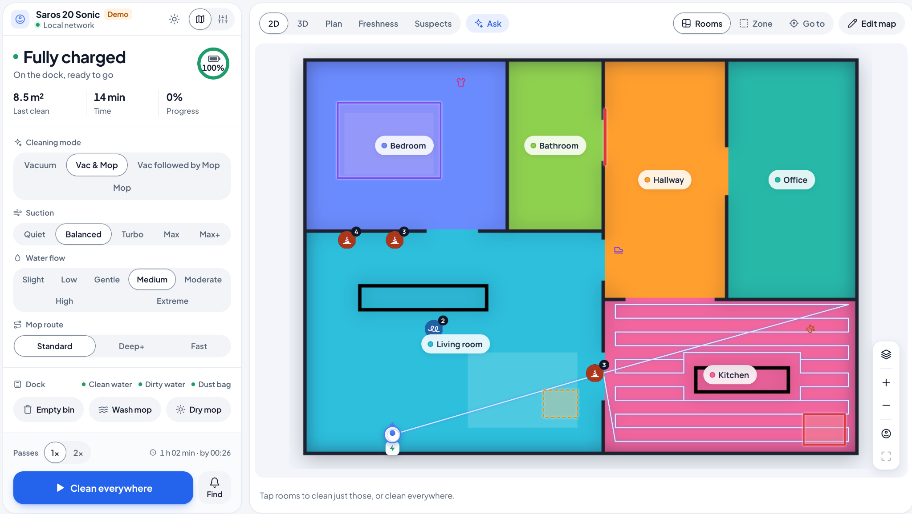

# Roborock web

A calm web app for your Roborock robot vacuum that runs on your own computer. It's built for a big screen, with a live map you can pan, zoom and turn in 3D, and it works on a phone too.



Try it without a robot or an account: `./start.command --demo`.

- **One screen**: the robot's status, cleaning mode, the dock and the main buttons sit in one panel beside the map, so on a laptop nothing you need is below the fold. It's light by default; Dark and Auto (follows your Mac) are on the theme button and in Settings → Appearance.
- **Live map** with room names, the robot and the dock. It updates every few seconds while the robot cleans.
- **Click rooms** to clean just those, **drag a zone**, or **click a spot** to send the robot there (**Esc** lets go of it again). Pick the passes above the button: 1–3 for rooms and zones (set when they start), 1 or 2 when cleaning everywhere. That one is the robot's own setting, shared with the Roborock app, so you can change it mid-clean too.
- **Move and zoom** the map like Google Maps: two-finger swipe, pinch, drag.
- **Three views**: the colour map, a **3D view** you can turn around, and a **floor plan** with room sizes.
- **What the robot saw**: carpets, obstacles it spotted (cables, shoes, pet mess…), their photos when available, where it mopped, and its route, on every view.
- **Edit the map**: invisible walls, no-go and no-mop zones, and merging, splitting or renaming rooms.
- **Start / pause / resume / stop / dock / locate**.
- **Cleaning mode**: Vacuum, Vac & Mop, Vac followed by Mop, Mop or Custom (SmartPlan is hidden; turn it back on in Settings → Appearance). You can also set suction, water flow and mop route.
- **Dock**: empty the bin, wash the mop, dry the mop, and see tank and dust bag warnings.
- **Settings**: volume, do not disturb, child lock, status light, carpet boost, auto-empty mode, mop wash mode, smart mop washing, auto drying.
- **Maintenance** (brush, filter and sensor life, with reset), **routines**, **cleaning history**, and device info.

It talks to the robot through [python-roborock](https://github.com/python-roborock/python-roborock), the same library Home Assistant uses. It goes over your local network when it can and through the Roborock cloud otherwise.

## Which robots work

- **Tested:** Roborock Qrevo S and Saros 20 Sonic / Saros 20 Sonic Complete.
- **Should work:** other Roborock vacuums that use Roborock's main ("V1") protocol, which is most of them: the S5, S6, S7 and S8 series, the Q5, Q7 and Q8 series, and the Qrevo family. Features your model or dock doesn't have (mop washing, drying, auto-empty, cleaning count…) are hidden.
- **Doesn't work:**
  - Roborock models on the newer protocols: the Dyad and Zeo, and some recent Q-series models. They sign in, but are listed as not supported.
  - Robots added to **Mi Home / Xiaomi Home** instead of the Roborock app.
  - Other brands (Dreame, Ecovacs, iRobot…).

If you try it with another model, please open an issue saying whether it worked.

## Start

You need Python 3.11+ (or [uv](https://docs.astral.sh/uv/)) and Node.js 18+.

```bash
git clone https://github.com/tommydino/roborock-web.git
cd roborock-web
```

macOS: double-click **`start.command`**. On macOS or Linux, from a terminal:

```bash
./start.command            # your robot
./start.command --demo     # a simulated Saros 20 Sonic, no account needed
```

The first run sets up a Python environment and builds the interface. After that, the app opens at http://localhost:8765. (On Windows, run it under WSL; that hasn't been tested.)

Sign in with the email you use in the **Roborock app**. You'll get a one-time code by email, just like the app sends. Mi Home / Xiaomi Home accounts are not supported.

For Docker Compose, run `docker compose up -d --build` from the cloned folder. To update an existing installation after a change on GitHub, run `git pull` followed by `docker compose up -d --build` in that folder. The named `roborock-web-data` volume keeps your sign-in and local history when the container is rebuilt.

### Options

| flag | |
|---|---|
| `--demo` | Simulated robot and apartment, so you can try everything safely |
| `--port 8765` | Change the port |
| `--host 0.0.0.0` | Open it from other devices on your Wi‑Fi (see the note below) |
| `--no-browser` | Don't open a browser window on start |
| `--debug` | Verbose logs |

## Moving around the map

| | Trackpad | Mouse | Touch screen |
|---|---|---|---|
| Move | Two-finger swipe, or click and drag | Drag | One finger, once zoomed in |
| Zoom | Pinch | Scroll wheel | Pinch |

Zoom always heads toward your cursor or fingers, and a quick drag glides a little when you let go. The buttons in the corner zoom, **center on the robot** (or press **R**) and **fit the whole map** (or press **0**). The arrow keys and **+ / −** work too.

While you're drawing a cleaning zone or editing walls, dragging draws instead of moving the map. A two-finger swipe still moves it, or hold **Space** and drag.

## Map views

Switch views with **2D / 3D / Plan / Freshness / Suspects** above the map. The app remembers your choice.

- **2D**: the colour map: every room in its own jewel tone (they glow on black in the dark theme), with the robot's path.
- **3D**: your home with raised walls and furniture, the robot and dock as little models, and invisible walls and zones as tinted glass. **Drag to turn** it, swipe with two fingers to move, pinch to zoom, and click rooms to pick them. Zones, go-to and editing switch back to 2D. The 3D library ([three.js](https://threejs.org), MIT) is bundled into a separate file that only loads the first time you open 3D.
- **Plan**: a blueprint, with each room outlined in its colour, carpets and a 1 m grid. Each room shows its floor area, and the footer adds up the area of the whole home or of the rooms you picked.
- **Freshness**: the floor coloured by how long ago each spot was cleaned. See below.
- **Suspects**: things that come and go on your floor, found from spots the robot usually reaches but sometimes can't. See below.

### What's on the map

Every view shows what the robot reports with its map. Use the **Layers** button (above the zoom buttons) to switch things on or off:

- **Cleaning path**: where it drove, with the stretches it mopped tinted blue.
- **Carpets**: hatched on the flat maps, slightly raised rugs in 3D.
- **Obstacles it spotted**: cables, shoes, clothes, pet waste, furniture, pedestals and more. Hover or click/tap an icon to see what the robot detected, its avoidance status and confidence when reported. If Roborock does not supply a name, the app explains that and shows the internal obstacle type code when available. Photos from the robot appear directly in the popup; if there are several, swipe or scroll through them. Click a photo to enlarge it. The full image is shown with a blue detection box when Roborock provides box coordinates. Photos and boxes depend on what the robot recorded for that object. The **No need to avoid, ignore?** action changes the robot's map and may not be individually reversible; use it only for an object you actually want the robot to ignore. Ignored objects are hidden from the live web map.
- **Walls & zones**: invisible walls, no-go, no-mop and no-carpet zones.

While it cleans a zone, the zone is outlined. When you send it to a spot, its target and planned route show up too.

## Room freshness

The phone app tells you what the robot is doing now. Freshness tells you what it's been doing: when each room, and each spot, was last cleaned.

- **The map** goes from pale (cleaned in the last day) to dark (over two weeks ago). Spots it never reached, in rooms it does clean, are darkest. That's usually under the bed, the sofa or a desk, or something left on the floor. Hover anywhere for the exact age, and when it was last mopped.
- **The panel** next to the map lists every room with when it was cleaned and mopped. Set how often each room should be cleaned (every day to every two weeks). Rooms past that are marked **Due**, and **Clean due rooms** sends the robot to just those, with your current cleaning mode. Click a room to pick it for a clean.

**Settings → History** lists cleaning runs with their duration, area and cleaning mode. Open a run for its map, route playback and timeline. Choose 1×, 3× or 5× playback speed; zoom with the map controls or mouse wheel, and drag the map while zoomed. Use the trash button beside a run to delete it from the robot and this app; the app asks the robot to delete the record and removes its local copy only after the robot confirms it. For supported robots, the app retrieves the detailed cleaning events from the robot, including room cleaning, mop washes and automatic re-mopping. If those events are unavailable, it shows events sampled while the app was running; room transition times from map updates are approximate. You can also import or edit an app timeline for one run, saved in this browser. Use **Download raw run data for timeline analysis** to export the record, device feature flags and original history map for investigation. This export includes private floorplan data. Some robots or individual records may not provide a route map. Playback timing is approximate because Roborock doesn't provide timestamps for individual route points. A run counts as cleaning a room once it covered half of its floor. History stays on your computer and every locally stored run is kept until you delete it.

## Suspects

A laundry basket, a bag, a chair pulled out: things that stand on the floor for a few days get in the robot's way. Suspects finds them in the same history Freshness uses, from spots the robot reaches on most runs like it but missed, as the same hole, on several runs in a row.

- **The map** marks each suspect with a numbered evidence tag: red while it's still there (**At large**), orange just after it left, yellow when it's long gone, grey once its case is closed. Hatched spots are **permanent residents**, floor it never reaches at all (usually under furniture).
- **The panel** has a wanted poster for each one: its rough size, room, how often it was in the way, and first and last seen. **Name a suspect** ("Laundry basket") and the name sticks to that spot. A named suspect that's been clear for 3 runs is **Case closed**.
- **The tape** steps through the runs. Press play to watch who arrived, stood there and left.
- A **person of interest** left a slightly different hole each time, so it might just be the robot taking another line.

Rooms need 10 finished runs with a map before they can have suspects. Runs are compared only with runs that covered the room in a similar way, so a schedule that keeps off the walls isn't mistaken for clutter. Suspects are guesses from where the robot couldn't go, not things it saw.

## AI assistant (optional)

Press **⌘K** (Ctrl+K) or **Ask** above the map and type, or say, what you want: "vacuum the kitchen and hallway twice", "send it home", "what got missed this week?". Claude (Opus 5.5) turns it into a plan using only the app's own actions, highlights the rooms on the map, and waits: **nothing moves until you press Run**. Each run in Freshness → Recent runs also gets an **Explain** link.

It's off until you add an Anthropic API key in **Settings → AI assistant** (saved in `data/anthropic.json`, readable only by you), or have `ANTHROPIC_API_KEY` set. When you use it, your request, room names and cleaning history are sent to Anthropic. Everything else works without it.

## Editing the map

Click **Edit map** above the map. The robot needs to be docked or paused.

**Walls & zones**: pick a tool on the left and drag on the map:

- **Invisible wall**: a line the robot won't cross
- **No-go zone**: an area the robot stays out of
- **No-mop zone**: an area it vacuums but won't mop

Click a wall or zone to move it, drag its dots to resize it, or delete it (trash button or **Delete** key). **Undo** with ⌘Z. Nothing reaches the robot until you click **Save to robot**. The robot replaces all its walls and zones in one go, so the app always sends the full set. It can store 68 corner points in total (a wall uses 2, a zone 4).

**Rooms**:

- **Merge** two neighbouring rooms into one.
- **Split** a room by drawing a line across it, wall to wall.
- **Rename** a room. This only changes the name in this app (saved in the app's local data folder). There's no documented way to rename rooms in Roborock's cloud, so the Roborock app keeps its own names. Rename there to change a name everywhere.

Merging and splitting change the map on your robot, and the app asks before doing either. You can undo one by doing the opposite (split what you merged, merge what you split).

If a map has no-carpet zones made in the Roborock app, the editor warns you: the app can't send those back, so saving walls and zones here may remove them.

## Privacy and security

- App data is stored outside the downloaded app folder so replacing it with an updated copy keeps your sign-in and local history. On macOS it is in `~/Library/Application Support/Roborock Web/data`; Linux and Windows use their usual per-user data folders. The first launch copies existing `data/` from this app folder or a matching Roborock Web folder in Downloads. The session file is readable only by your account. **Sign out** in Settings to remove the saved session.
- Cleaning history and room names stay on your computer in this local data folder.
- The last map is kept there too, so the app can show it straight away after a restart (and while the robot is offline).
- Set `ROBOROCK_WEB_DATA_DIR` to choose a different persistent data folder.
- The app only talks to Roborock's servers and to your robot.
- By default it only listens on `localhost`. With `--host 0.0.0.0`, **anyone on your network can control the robot**. There's no password, so only do this on a network you trust.

## Good to know

- The map comes from the robot. If it says "No map yet", let it finish one full clean first.
- If the robot has several saved floors, a map picker appears next to the map tools.
- Room names come from your Roborock account. Rename rooms in the official app.
- Settings your model doesn't support are simply hidden. If the robot can't be reached, Settings says so, and its settings come back by themselves once it's online.
- Roborock limits sign-in codes (a few per minute, about 10 an hour, 20 a day). If it stops sending them, the app keeps the code box open, so a code you already got by email still works (or use **Already have a code?**). The block often clears within an hour but can last until the next day, and every new try can extend it.
- There's no way around the codes: Roborock now asks for an email code even when you sign in with a password.
- If the robot or Roborock isn't responding, use **Reconnect**. It retries with your saved sign-in. Signing out means you'll need a new code to get back in.
- The app talks to the robot directly on your home network when it can, and through Roborock's cloud otherwise (maps always come through the cloud). It remembers the robot's address, and looks for it on the network if needed, so a cloud outage doesn't cut you off. Settings → About shows which ways are up.
- On macOS, the app you start it from (Terminal, iTerm…) needs **Local Network** access for that direct link: System Settings → Privacy & Security → Local Network. Without it the app can only use the cloud, and it tells you so.
- A log of what the app did, connections included, is kept in the local data folder as `app.log` (it rotates, so it stays small).

## Development

The backend is Python (FastAPI + python-roborock). The interface is TypeScript in `web/`, which esbuild bundles into `static/dist/`.

```bash
npm install
npm run dev        # rebuild on every change, then just reload the page
npm run typecheck  # strict type check
npm run build      # one-off build (start.command does this for you)
```

Python changes need a server restart. If the app notices code changed since it started, or the interface wasn't rebuilt, it shows a "restart to finish updating" banner.

## Files

| | |
|---|---|
| `server.py` | Web server and API |
| `robot.py` | Login session and robot control (python-roborock) |
| `maprender.py` | Turns the robot's raw map into a soft PNG, a room mask, and walls/zones for the editor |
| `history.py` | Cleaning history: each run's coverage, and room freshness worked out from it |
| `suspects.py` | Suspects: things that come and go on the floor, worked out from the same history |
| `demo.py` | The simulated robot behind `--demo` |
| `web/` | The interface in TypeScript: `main.ts` (start-up), `panels.ts` (the control panel: status, mode, dock and the main buttons), `session.ts` (sign-in, polling), `settings.ts`, `freshness.ts`, `suspects.ts`, `map/` (map, pan & zoom, editor, views, fit), `map3d.ts` (3D) |
| `static/` | `index.html`, `styles.css`, and the built bundle in `dist/` |

## License

[MIT](LICENSE). Not affiliated with or endorsed by Roborock; "Roborock" and "Qrevo" are their trademarks.
